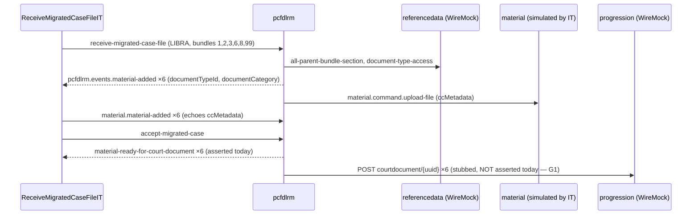

# 02 — Design

- **Story:** DD-33262. Inputs: `00-input-brief.md`, `01-requirements.md`.
- **Shape:** test-only. No production code, schema, subscription or event changes. No ADR: nothing
  architecturally significant is decided; the "prove, don't reroute" scope is recorded in
  `01-requirements.md`.

## Flow under test (unchanged)

## Why the IT can't verify Progression as it stands

1. **The echoed `documentTypeId` is random.** `getCCMetadataJsonObject` (`ReceiveMigratedCaseFileIT.java:549-567`)
   sets `documentTypeId` to `randomUUID()`. `MaterialEventProcessor.handleDocumentUploadedEvent` (`:157-184`)
   builds the court document's `documentTypeId` from that echo, so what reaches Progression is the
   fixture's random value, not reference data. The real Material context echoes back the ccMetadata pcfdlrm
   sent (`uploadToMaterialContext`), so the IT should do the same.
2. **No WireMock verification** of `ProgressionStub.ADD_COURT_DOCUMENT_COMMAND`; only
   `initiatecourtproceedings` is ever read back.

## Changes

All in `pcfdlrm-integration-test`, plus one unit test in `pcfdlrm-event-processor`.

### C1 — Echo pcfdlrm's document type, and check it against reference data

- Add an expected-values map alongside `LIBRA_BUNDLE_LEVELS`, derived from the IT stubs
  (`referencedata.query.get.all-parent-bundle-section.json` → section;
  `referencedata.get-all-document-type-access.json` → id):

  | Bundle | Bundle code → section | documentTypeId | Level |
  |---|---|---|---|
  | 1 | IDPC → IDPC bundle | `460f6f7a-c002-11e8-a355-529269fb1662` | Defendant |
  | 2 | MCE → Magistrates' court evidence bundle | `540f6f7a-c002-11e9-a355-529269fb1662` | Defendant |
  | 3 | S9 → Witness Statements | `530f6f7a-c002-11e9-a355-529269fb1662` | Case |
  | 6 | UM → Unused material | `550f6f7a-c002-11e9-a355-529269fb1662` | Defendant |
  | 8 | WS → Witness Statements | `530f6f7a-c002-11e9-a355-529269fb1662` | Case |
  | 99 | PSJH → Private section - Judges & HMCTS | `520f6f7a-c002-11e9-a355-529269fb1662` | Defendant |

  Confirmed against the `MaterialAdded` events on the first IT run.
- In `shouldSendEveryAcceptedLibraBundleForCourtDocumentOnAccept`, read `documentTypeId` from each
  `MaterialAdded`, assert it equals the map entry for the bundle, and pass it to the echo.
- Add a `createMaterialAddedPayload` overload taking `documentTypeId`. Existing callers keep the random id,
  so no other test changes.

### C2 — Verify the `add-court-document` requests Progression receives

- After the existing `material-ready-for-court-document` loop, await (30 s, like `receiveMigratedCaseFileWithAllHearingsSkipped`)
  until `findAll(postRequestedFor(urlPathMatching(ADD_COURT_DOCUMENT_COMMAND + ".+")).withRequestBody(containing(caseId)))`
  holds one request per material the test echoed. Filter on `caseId` because the WireMock journal is shared
  across ITs.
- Progression's `add-court-document` takes `materialId` as the URL path parameter (`courtdocument/{materialId}`),
  and the body is the bare payload `{courtDocument}`, not an envelope. Key each body by the path's
  `materialId`. Then check:
  - the set of path `materialId`s is exactly the set of echoed ids, with no duplicates;
  - `courtDocument.materials[0].id` is that `materialId` (FR-1);
  - `courtDocument.documentTypeId` is the C1 map entry for that material's bundle (FR-1, AC-1);
  - **case level** (bundles 3 and 8): `documentCategory.caseDocument.prosecutionCaseId` is `caseId`, and there is no
    `defendantDocument` (AC-2);
  - **defendant level**: `documentCategory.defendantDocument.defendants` is `[defendantId]`, the fixture's
    only defendant (AC-3).
- Put the request lookup in a helper method on `ReceiveMigratedCaseFileHelper`, next to the
  `initiatecourtproceedings` readers: `addCourtDocumentRequestsByMaterialIdFor(String caseId, int expected) : Map<String, JsonObject>`. Use
  `ProgressionStub.ADD_COURT_DOCUMENT_COMMAND` rather than a new literal.
- Keep the internal-event assertions. They pin the aggregate's output, and C2 pins the boundary.

### C3 — Unit test: the processor forwards the payload unchanged

`MaterialReadyForCourtDocumentProcessorTest` currently asserts only the outgoing name, with a `NULL` payload.
Extend it with a non-empty `{materialId, courtDocument}` payload, and assert the sent envelope's payload is
equal to it and that the metadata keeps the source envelope's id/causation. This is the cheap unit-level
half of G1.

## Defect handling (FR-3)

If C2 fails for a reason other than a fixture fact, for example wrong category, missing request or
duplicated request:
1. Write a failing unit test at the lowest layer that shows it (aggregate or processor).
2. Make the minimal production fix.
3. Note it in this file under a "Defect found" heading before raising the PR.

## Not changed (recorded in `01-requirements.md`)

- G2: multi-defendant attachment to all defendants (DD-43463 behaviour), pending the LIBRA per-material
  defendant question.
- G3: V2 rules.
- G4: documentqueue.
- XHIBIT paths and all other ITs.

## Risks

| Risk | Mitigation |
|---|---|
| Flaky count because of the shared WireMock journal | Filter by the test's random `caseId` and its own echoed `materialId`s, and assert "exactly one per material" rather than a global count |
| Body isn't an envelope | Confirmed on the first run: the body is the payload, and `materialId` is the path parameter. The helper parses a plain `JsonObject` keyed by the path |
